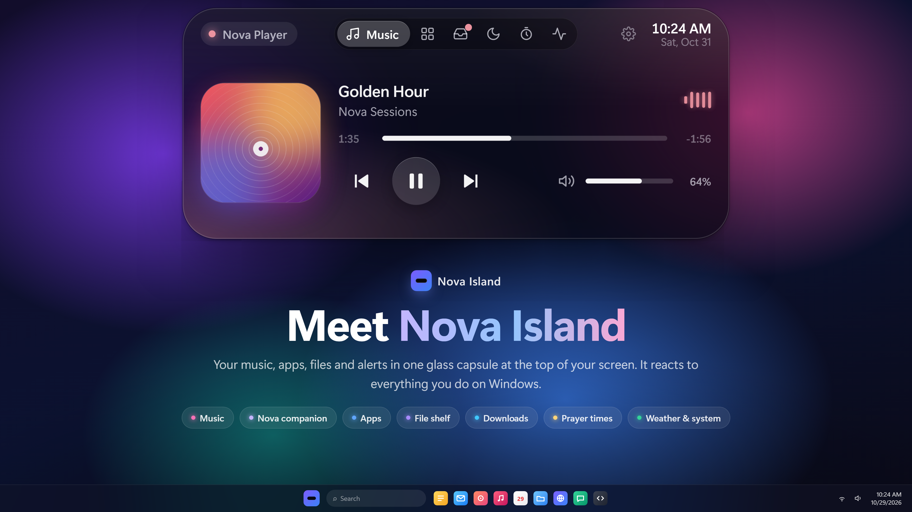
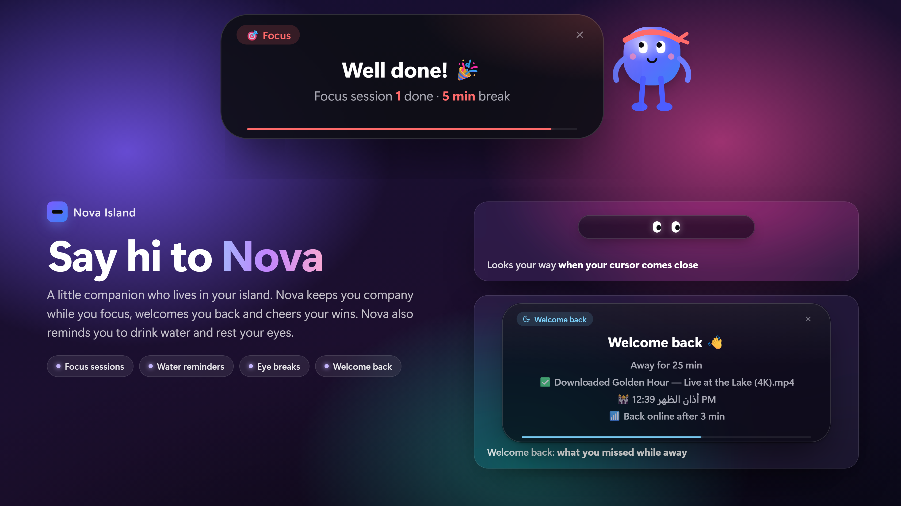
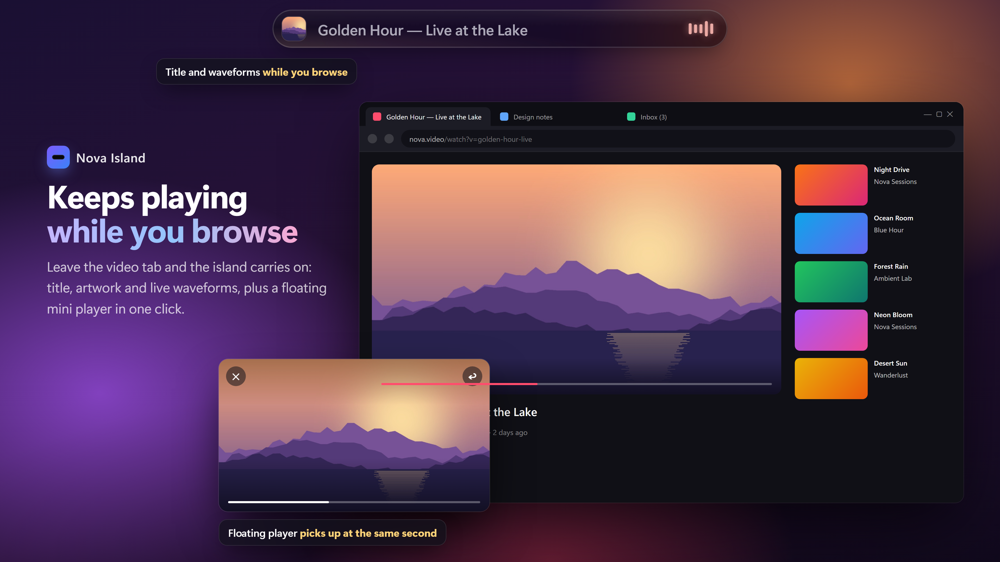
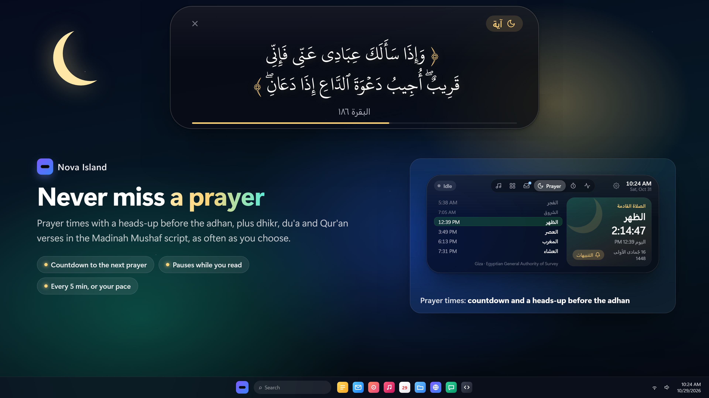
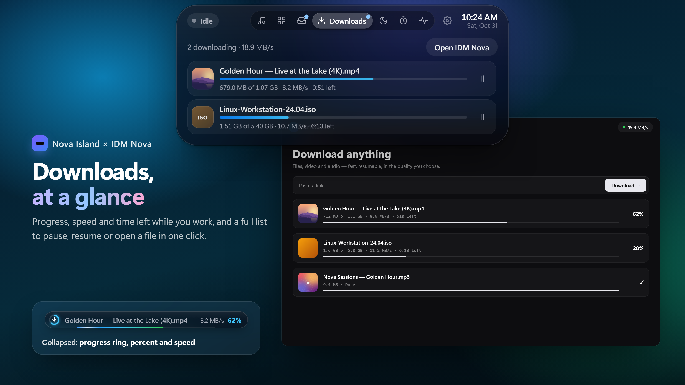
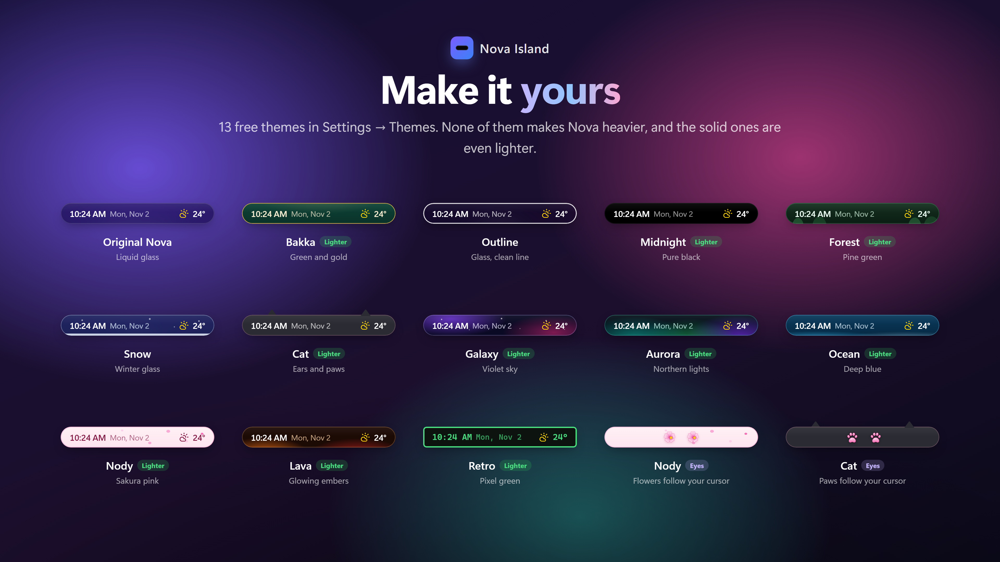
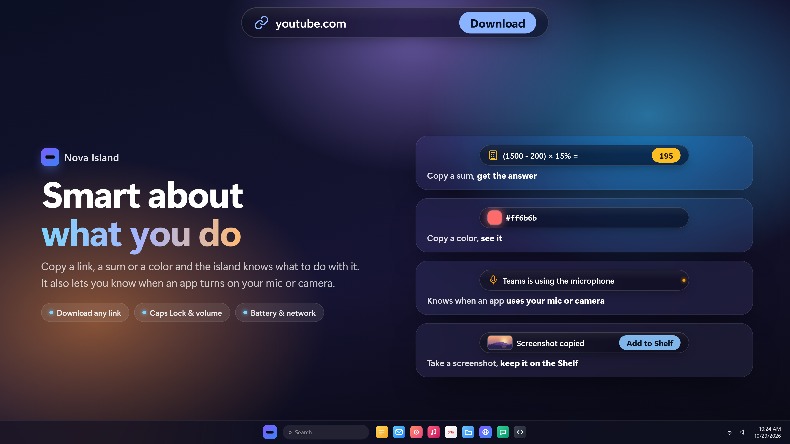
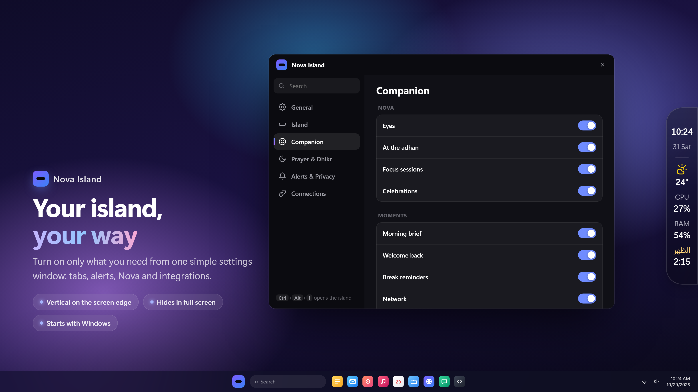

<div align="center">

# Nova Island

**A living island for your Windows desktop.**

Your music, apps, files and alerts in one glass capsule at the top of your screen — with Nova, a little companion who keeps you company.

[**Download for Windows**](https://nova-tech-kit.github.io/nova-island/) · [Microsoft Store](https://apps.microsoft.com/detail/9PHV3N1V2H7M) · Free and open source (GPL v3)

[](../../releases/latest)
[](../../stargazers)
[](https://ko-fi.com/binamer)
[](https://t.me/nova4apps)



</div>

## Features

### Say hi to Nova
A little companion who lives in your island. Nova keeps you company while you focus, welcomes you back, cheers your wins, and reminds you to drink water and rest your eyes.



### Keeps playing while you browse
Title, artwork and live waveforms of whatever is playing, plus a floating mini player in one click.



### Never miss a prayer
Prayer times with a heads-up before the adhan, plus dhikr, du'a and Qur'an verses in the KFGQPC Hafs script, as often as you choose.



### Downloads, at a glance
Progress, speed and time left while you work, with IDM Nova — pause, resume or open a file in one click.



### Make it yours
13 free themes in Settings → Themes, from liquid glass to pure black, sakura pink and pixel green. None of them makes Nova heavier, and the solid ones are even lighter.



### Smart about what you do
Copy a link, a sum or a color and the island knows what to do with it. It also lets you know when an app turns on your mic or camera.



### Your island, your way
Turn on only what you need from one simple settings window. Vertical on the screen edge, hides in full screen, starts with Windows.



## Install

1. Download **Nova Island** from [the website](https://nova-tech-kit.github.io/nova-island/), or get it from the [Microsoft Store](https://apps.microsoft.com/detail/9PHV3N1V2H7M).
2. Run it. With the direct download, Windows may show "Windows protected your PC" because the app is not code-signed yet — choose **More info → Run anyway**. The Store version doesn't show it.
3. The island appears at the top of your screen. Press **Ctrl + Alt + I** to open it.

Requires Windows 10 or 11 (64-bit).

## What's new in 1.8.18

- **Boost panel visual polish & RTL BiDi fix**: Fixed Chromium's native green/gray `<progress>` bar bleeding over the circular RAM gauge ring (caused by combined vendor pseudo-element selectors), separated the crisp circular arc renderer from the semantic screen-reader `<progress>` element, and isolated `GB`/`MB` units in Arabic RTL so numbers and capacity ratios display cleanly without flipping or clipping.

## What's new in 1.8.17

- **High-effectiveness deep Cache Cleaner & RAM Booster**: Expands cleanup to cover Windows Temp, INetCache, WER/CrashDumps, stale Explorer thumbcaches, GPU shader caches (DirectX/AMD/NVIDIA/Intel), Chromium/Firefox disposable caches (`Cache_Data`, `Code Cache`, `GPUCache`, `GrShaderCache` — never cookies, logins, or history), and heavy desktop app caches (Discord, VS Code, Steam, Spotify), paired with largest-first two-pass process working-set trimming (`SetProcessWorkingSetSizeEx` + `K32EmptyWorkingSet`), DNS flush, heap compaction, and kernel Standby/Modified list purge + Memory Combining when elevated.
- **Live-synchronized RAM progress ring**: Replaces the static ring with a clickable semantic `<progress>` ring driven by real-time streamed `boost-progress` snapshots so the circle visibly empties step-by-step in lockstep with real Windows RAM reclamation and immediately refreshes the island's live RAM readout.

## What's new in 1.8.16

**Exact Chrome "Thin line" hit-box & instant hover-in / hover-out** — snaps the native hit-box immediately to the exact `96×6` top bar on collapse and ignores stale shrinking rects (ending premature triggers ~1 cm away from Chrome tabs), wakes `reportLoop` immediately instead of waiting 2.5 s, removes the redundant 160 ms JS hover-out delay, lowers dwell/leave timers to 45 ms / 35 ms at 60 Hz cursor polling, and debounces WebView2 `LOW`-memory mode by 20 s so opening and closing are crisp and instantaneous with zero compositor stall.

**Reliable Prayer Timings, Native Wake Alarms & Improved Adhan/Iqama UX** — adds a native Win32 `TIMER_PRAYER` wake alarm in Rust so Pre-Prayer, Adhan, and Iqama alerts fire on the exact second even when WebView2 is idle/throttled/hidden; queues Iqama cleanly after active Adhan audio instead of getting hidden behind the Adhan scene; prevents bell chime clashing with Adhan MP3; adds **Calculation method**, **Time adjustment (`-15..+15 min`)**, a **Test prayer alert** button, clearer **Hanafi Asr** guidance, and renames the Adhan reset button to **Remove file** so downloaded reciters aren't accidentally removed.

**One-Click Windows Cache Cleaner & RAM Booster** — adds a sleek ⚡ topbar button opening an animated theme-aware **RAM & Cache Boost** sheet inside the island (0% idle overhead) that safely cleans Windows temp caches (`%TEMP%`, `CrashDumps`, `D3DSCache`, `INetCache`, `Windows\Temp`), flushes DNS cache, trims process working sets via Win32 `K32EmptyWorkingSet`, and reports exact freed RAM and cache MB in real time.

## What's new in 1.8.15

**Accurate consecutive browser video tracking & downloading** — ranks Windows SMTC sessions by active playback and foreground browser window, includes video duration in change detection, and always re-probes the live foreground browser URL when clicking Download so watching multiple videos back-to-back updates Media immediately and downloads the current video rather than an older one.

**Deduplicated Screenshot Alert with On-Demand Pin** — eliminates duplicate stacked floating windows from Windows 11 Snipping Tool clipboard updates via content fingerprinting, and replaces automatic popups with a sleek 5-second island alert featuring a one-click **Pin (`📌 تثبيت`)** button to float captures at `1:1` size only when you want them (optional **Auto-pin immediately** remains available in Settings).

**Universal Island Pin Button & Edge-Stability Fix** — adds an always-available Pin toggle button in the expanded island topbar (synced with `Ctrl+Alt+I`), adds a 240 ms leave grace window with generous edge bounds and Windows 11 shell-overlay exclusions so the island no longer vanishes prematurely near screen edges.

**Optional Weather (off by default) & Dedicated Clipboard Tab** — turns weather fetching off by default (`Settings › Island › Weather`) to save memory and network wakeups, and dedicates the expanded Clipboard tab cleanly to your 50-item clipboard history while keeping CPU/RAM meters on the awake idle pill.

**Built-in Stopwatch** — adds a count-up **Stopwatch** inside the Timer tab (Start / Pause / Resume / Reset, shown on the compact pill while running, `0%` idle CPU when stopped).

**Customizable Prayer & Iqama Alerts + Curated Online Adhan Library** — configure pre-prayer reminder timing (`Off`, `5`–`30 min`), Iqama delay (`5`–`30 min`), pre-Iqama heads-up (`At iqama`, `1`–`10 min`), selectable Web Audio notification chimes with instant preview, and optional one-click online Adhan MP3 downloads (Makkah, Alafasy, Abdul Basit, Refaat, Minshawi, Qatami, and Fajr Adhan) cached locally on disk with zero ongoing RAM or network cost.

## What's new in 1.8.14

**Region Screenshot & Native 1:1 Floating Pin Overlay (`PrtScn` / `Ctrl+Alt+S`)** — captures taken through Windows' built-in Snipping overlay (`PrtScn`, `Win+Shift+S`, `Ctrl+Alt+S`, or tray **Snip & pin**) immediately stay on screen in a crisp, frameless native Win32 floating window at their exact `1:1` captured pixel size, pinned Always-on-Top above other apps without opening any editor or WebView (`0%` idle CPU). Drag anywhere to move; hover to toggle Always-on-Top or close; press `Esc` / double-click / middle-click to dismiss; right-click for Always-on-Top, Copy image, Save as PNG, or Close all. Toggleable under **Settings › Alerts & Privacy › Pin screenshots on screen**.

**Configurable Clipboard History (up to 50 items & auto-expiry)** — expanded the System tab clipboard history from 8 to up to **50** items with full Settings controls under **Settings › Alerts & Privacy › Clipboard history**: choose **History limit** (`5`–`50` items), **Auto-clear after** (`Never`, `5 min`–`7 days`), and **Save history on this PC** (persists non-pinned history safely across restarts while password-manager private copies remain excluded, and deletes the saved file immediately if turned off). Expiry runs O(1) inside the existing stats tick with zero extra background threads or timers.

## What's new in 1.8.13

**Lower idle CPU & RAM across every theme** — stops invisible slide blur filters and off-screen progress bar layout animations while the island is resting or collapsed as a thin line, converts the system pollers (`nova-sys` foreground snapshot, `vlc` `IsWindow` fast-path + scan backoff, zero-alloc recorder detection, popup-resistant `BrowserTracker`), and moves `renderer.js`, Prayer, Reminders, Companion, Tasks, System, NetSpeed, and Nova eyes onto demand-driven timers and guarded DOM writes (eliminating ~99% of idle `Layout` passes and cutting idle CPU ~3.2× on glass and ~45% on solid themes).

**Background Radio & Timer reliability** — defers WebView2 suspension cleanly after hiding, skips suspension and adds a native Win32 alarm (`TIMER_FINISH`) so active Quran Radio audio and Timer/Focus completion alerts continue working reliably even when the island is hidden or in fullscreen mode, and wakes the page cleanly on "Update now" / radio playback.

**Independent updater rows & clear fork status** — separates ready-update tracking (`source`) and 24h error logs between `NOVA-TECH-KIT/nova-island` and `sem233/nova-island`, and reports clear localized error reasons (such as HTTP 404 when the fork repository is private or lacks `latest.yml`).

## What's new in 1.8.12

**Drastically lower idle RAM & CPU** — switches WebView2 to `MemoryUsageTargetLevel::LOW` whenever the island is resting collapsed and restores `NORMAL` on hover/pin/interaction, suspends WebView2 (`TrySuspend`) and pauses CSS animations when the island is hidden, deduplicates `media` IPC updates, slows idle stats/layout/reminder polling, and guards Prayer DOM updates so all animations and features stay identical while cutting idle memory and CPU usage dramatically.

## What's new in 1.8.11

**Sleeker browser-tab indicator ("Thin line")** — redesigned the `#island.addr-line` browser-tab micro-notch (`96×6 px`) across all themes so theme decorations (`--th-deco`), update dots, cat ears, and blur backdrop artifacts no longer bleed across Chrome/Edge tab headers; replaces the harsh striped bar with a clean top-docked capsule and centered theme-accent handle that expands smoothly into the full island on hover or click.

**Clean release artifact staging** — cleared cached installer executables in the GitHub Actions release workflow before building NSIS packages so only the active release's setup, portable executable, and `latest.yml` manifest are published.

## What's new in 1.8.10

**Island Calculator add-on** — click the new calculator icon next to News/Settings in the expanded topbar to open a compact DPI-scaled calculator (`+`, `−`, `×`, `÷`, decimals) with live preview, standard operator precedence, Arabic-Indic digit normalization (`٠-٩`, `٫`), LTR display/grid preservation in Arabic UI, hold-to-repeat backspace, full theme & blur/solid/no-animation support, and an on/off toggle under **Settings › Island › Tools › Calculator**.

**Dual-source update check (`sem233/nova-island` + official)** — kept **Check for updates** pointing to the upstream `NOVA-TECH-KIT/nova-island` repository, added a dedicated **Check fork updates (`sem233/nova-island`)** button in **Settings › General**, updated the app updater version baseline to `1.8.10`, and added `latest.yml` manifest generation + upload to the release workflow so in-app fork updates download and install automatically.

## What's new in 1.8.9

**Reliable SPA & HLS video extraction** — added an audio-muted WebView2 runtime stream sniffer fallback for JavaScript-rendered video pages (such as `cinejoy.pk`), separated `sourcePage` / `Referer` / `Origin` headers for both probing and downloading via `yt-dlp`, upgraded generic stream filenames (e.g. `master`) to clean page titles, restored strict TLS certificate verification, and surfaced specific error messages for TLS, DRM, login walls, anti-bot gates, and unsupported links.

**Clipboard scrolling in System** — fixed flex/grid overflow sizing, wheel-event routing, and drag exclusions so scrolling inside both `#clip-list` and long `.clip-full-text` snippets works smoothly without changing system volume or dragging the island window.

**Overlay click-through & dim fixes** — fixed stuck dimming (`nova-dim`) and unclickable states across `ghost`, `clickable`, `pinned`, and `toggle` transitions, cleared stale browser tab intersections immediately on window switch, prevented expanded panel geometry from overwriting collapsed `rest_rect`, and raised overlay dim opacity cleanly while preserving intended click-through over browser tabs.

**UTF-8 QuickClips & test reliability** — kept UTF-8-safe clip truncation (`clips.rs`) and made calendar parity tests deterministic across CI timezones (`cargo test --workspace --locked`).

## What's new in 1.8.8

**Video downloader (MDM)** — download any video or high-quality MP3 stream from the browser in one click. Hover the download button to pre-fetch formats instantly; pick 4K, 1080p, 720p, 480p, 360p or MP3 320 k from the quality drawer. Requires [yt-dlp](https://github.com/yt-dlp/yt-dlp) and [ffmpeg](https://ffmpeg.org/) in PATH or beside the app.

**QuickClips manager** — save up to 200 text snippets, pin the ones you use most, copy any clip back to the clipboard in one click, and add from clipboard with the paste button. Clips are stored locally (`userData/clips.json`); nothing leaves your machine.

**IDM Nova downloads** — progress, speed, time left and ETA for each active IDM Nova download shown directly on the island; pause, resume, cancel or open/reveal a file without switching windows.

**Smart clipboard** — copy a URL, a math expression (e.g. `12 * 4 + 8`) or a hex/RGB color and the island shows the right action: open/download the link, compute the result with one tap to copy it, or preview the color swatch.

## Build from source

Nova Island is written in Rust; the app is in [`nova-next/`](nova-next/). You need Windows 10/11 and
[Rust](https://rustup.rs) (MSVC toolchain):

```bash
cd nova-next
cargo build --release -p nova-app     # target/release/nova-island.exe
```

Everything else (how the pages and the app fit together, tests, the installers) is in
[nova-next/README.md](nova-next/README.md). Want to help? Read [CONTRIBUTING.md](CONTRIBUTING.md) first.

## Support Nova Island ☕

Nova Island is free, with no ads and no tracking, and it always will be. If it makes your day a little better, you can buy us a coffee:

- **Ko-fi** (cards, PayPal): [ko-fi.com/binamer](https://ko-fi.com/binamer)
- **InstaPay** (Egypt): [Send via InstaPay](https://ipn.eg/S/binamerbm/instapay/38txJO)

Stars ⭐ and sharing it with a friend help a lot too.

## License

Nova Island is free software, licensed under the [GNU General Public License v3.0](LICENSE).

Copyright © 2026 Nova Island by AmerTech.

The Qur'an font in `fonts/` (KFGQPC HAFS Uthmanic Script by the King Fahd Glorious Quran Printing Complex) is included unmodified under its own license — see [fonts/KFGQPC-LICENSE.txt](fonts/KFGQPC-LICENSE.txt). It is not covered by the GPL. The Aref Ruqaa font in `nova-next/assets/fonts/` is under the SIL Open Font License — see [OFL.txt](nova-next/assets/fonts/OFL.txt).

The name "Nova Island" and its logo are not covered by the GPL; please use a different name for modified versions.
